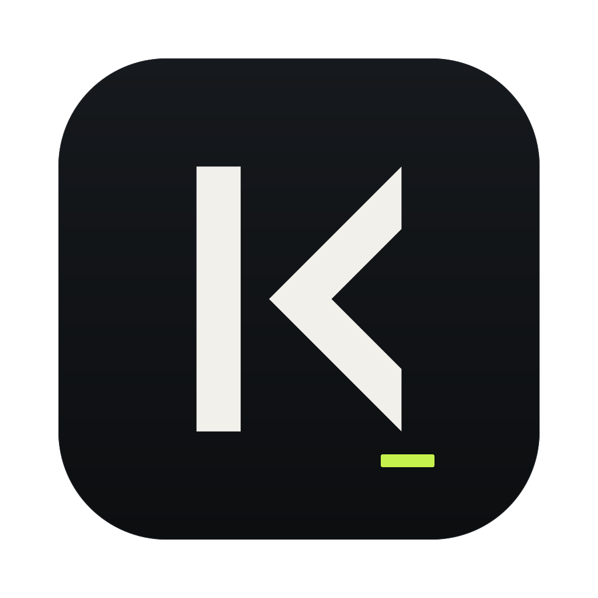

<p align="center"></p>

# KodeVertex Terminal

*A reading-friendly terminal for macOS with Claude Code integration (Tauri 2 + React + TypeScript). Early foundation stage.*

Терминал, удобный для чтения: крупный аккуратный текст, встроенные шрифты с кириллицей, темы и интеграция с Claude Code.

## Что уже работает

- окно в духе Warp: лента блоков сверху, строка ввода, панель агентов и статус-бар снизу;
- блоки команд (OSC 133): у каждой команды своя карточка с выводом, временем и цветами; блоки выделяются ⌘↑ / ⌘↓,
  вывод копируется ⌘⇧C, очень длинный вывод сворачивается с кнопкой «Показать всё»;
- полноэкранные и интерактивные программы (vim, htop, less, ssh, `sudo`, `read`) работают как в обычном терминале;
- строка ввода: история команд (↑ / ↓), автодополнение путей с предпросмотром, многострочные команды, вставка;
- интеграция с Claude Code: ⌘↵ отправляет вопрос агенту, ответы, действия и правки показываются карточками в той же
  ленте (markdown, таблицы, код с подсветкой), ⌃C прерывает ход, сессия продолжается после перезапуска;
- панель агентов: главный агент и субагенты деревом — модель, что делают сейчас, время и токены, подробности по ↵;
- статус-бар: текущий агент, проект, ветка, модель и заполнение контекста;
- уведомления: агент ждёт ответа или закончил, долгая команда завершилась (в окне и системные, когда окно не в фокусе);
- вкладки (точка показывает состояние агентов) и разделение панелей (вправо и вниз);
- zsh с собственной интеграцией через `ZDOTDIR` (ваши `~/.zshrc` и прочие файлы не меняются и подгружаются как обычно);
- темы (по умолчанию Android Studio) и встроенные шрифты с кириллицей, настройка размера и межстрочного интервала;
- окно настроек, конфиг в TOML.

## В планах

- релизы для разных платформ.

## Сборка из исходников

Нужны [Rust](https://rustup.rs) (`rustup`), Node.js и Xcode.

```sh
npm i
npm run tauri dev     # запуск в режиме разработки
npm run tauri build   # сборка .app и .dmg
```

Готовый `.dmg` появится в `src-tauri/target/release/bundle/dmg/`.

## Первый запуск на macOS

Приложение не подписано, поэтому macOS может отказаться его открыть. Откройте его через правый клик → «Открыть», либо снимите карантин:

```sh
xattr -dr com.apple.quarantine "/Applications/KodeVertex Terminal.app"
```

## Горячие клавиши

| Действие | Клавиши |
|---|---|
| Разделить вправо | ⌘D |
| Разделить вниз | ⌘⇧D |
| Новая вкладка | ⌘T |
| Закрыть панель | ⌘W |
| Фокус на соседнюю панель | ⌥⌘ + стрелки |
| Вкладка 1–8 / последняя | ⌘1–⌘8 / ⌘9 |
| Предыдущая / следующая вкладка | ⌘⇧[ / ⌘⇧] |
| Увеличить / уменьшить / сбросить шрифт | ⌘+ / ⌘- / ⌘0 |
| Выбрать блок выше / ниже | ⌘↑ / ⌘↓ |
| Скопировать вывод блока | ⌘⇧C |
| Отправить вопрос агенту | ⌘↵ |
| Перейти в панель агентов | ⌘↓ (из строки ввода) |
| Скрыть / показать панель агентов | ⌘J |
| Прервать команду или ход агента | ⌃C |
| Очистить ленту | ⌃L |
| Настройки | ⌘, |

## Конфиг

`~/.config/kodevertex-terminal/settings.toml`

## Лицензия

[MIT](LICENSE)
