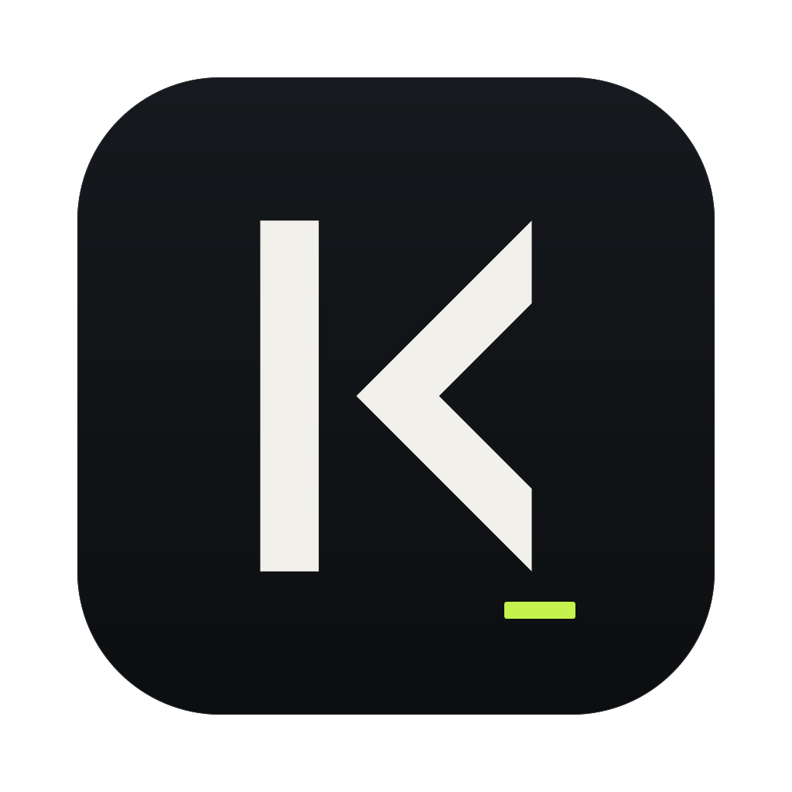
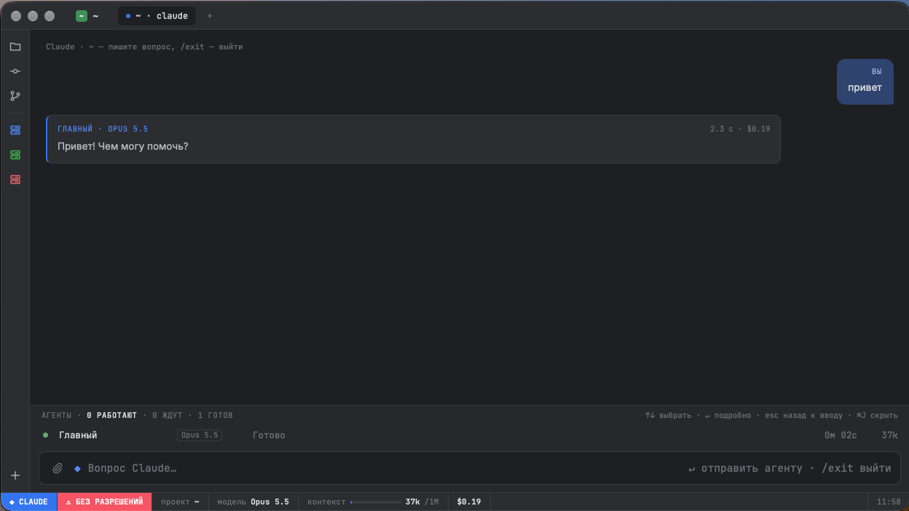
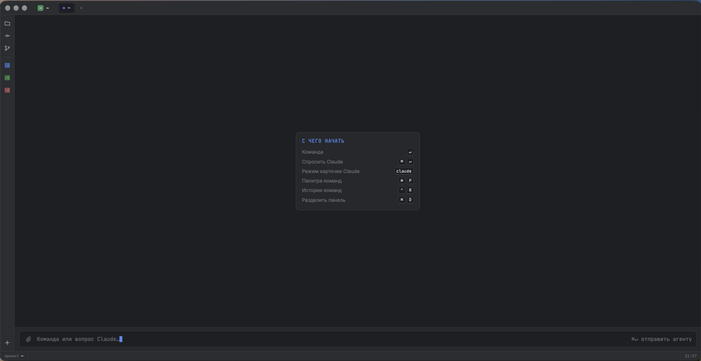

<p align="center"></p>

# KodeVertex Terminal

*A reading-friendly terminal for macOS with Claude Code built in (Tauri 2 + React + TypeScript + Rust): command blocks, Claude Code sessions as cards, agents panel, an Android Studio–style project panel, quick SSH launchers and notifications.*

Терминал для macOS, удобный для чтения: крупный аккуратный текст, встроенные шрифты с кириллицей, темы и Claude Code прямо в ленте — без полноэкранного TUI.

<p align="center"></p>

<p align="center"></p>

## Возможности

### Терминал
- **Лента блоков** (OSC 133): у каждой команды своя карточка с выводом, кодом выхода и временем. Блоки выбираются ⌘↑ / ⌘↓, вывод копируется ⌘⇧C, очень длинный вывод сворачивается, заголовок блока прилипает сверху.
- **Строка ввода как в Warp**: история (↑ / ↓ и поиск ⌃R), серая подсказка из истории, автодополнение путей с предпросмотром, многострочные команды.
- **Полноэкранные программы** (vim, htop, less, ssh, `sudo`) работают как в обычном терминале.
- **Вкладки и панели**: разделение вправо / вниз, точка на вкладке показывает состояние агента.
- **«Спросить Claude»** на упавшей команде (⌘⇧A) и **«Повторить»** выбранную (⌘R).
- **Поиск в ленте** ⌘F, **палитра команд** ⌘P.
- **Сессия сохраняется**: вкладки, панели, лента и разговоры с Claude возвращаются после перезапуска.
- zsh со своей интеграцией: ваши `~/.zshrc` и прочие файлы не меняются и загружаются как обычно.

### Быстрые входы (ssh и любые команды)
- **«+» внизу левой полосы** — сохранить команду входа: `ssh deploy@203.0.113.10`, `docker exec -it api sh`, `kubectl exec …`, `claude` и т. п.
- У каждого входа своё **название, значок и цвет** — легко отличить прод от стейджа.
- Клик открывает **свою вкладку** и выполняет команду. Пока сессия идёт (зелёная точка) — клик просто переключает на неё; если вы вышли с сервера (`exit`) — лента очищается и команда запускается заново.
- Правый клик по значку: открыть, изменить, удалить.

### Claude Code
- `claude` в строке ввода или ⌘↵ — разговор с Claude **карточками в той же ленте**: markdown, таблицы, код с подсветкой, диаграммы mermaid картинкой.
- **Действия и правки** — карточками; правки показываются диффом с подсветкой языка файла; план (TodoWrite) — отдельной карточкой.
- **Запросы разрешений и вопросы** агента — над строкой ввода; режим разрешений меняется в настройках сразу для открытых сессий.
- **Панель агентов**: главный агент и субагенты деревом — модель, что делают сейчас, время и токены.
- **Изменить отправленное сообщение**, **очередь сообщений**, пока Claude занят, **ответ на выделенный фрагмент** ответа (⌘L).
- `/model` (модель и effort, 1M контекста), `/resume` (прошлые разговоры), `/clear`, `/exit`.
- Стоимость хода и сессии, заполнение контекста в строке состояния.
- **Режим чтения** длинного ответа (⌘R) с оглавлением и размером текста.
- Вложения: файлы и скриншоты значками в строке ввода (перетащить из Finder, ⌘V, `@` для поиска файлов).

### Проект (как в Android Studio)
- Левая полоса: **Проект** (дерево файлов, ⌥⌘1), **Изменения** (git status, ⌥⌘0), **Git** (лог коммитов, ⌥⌘9).
- Просмотр файлов и диффов вкладками справа, «Закрыть все» — одной кнопкой.
- Панель следует за каталогом активной вкладки и обновляется после команд.

### Уведомления
- Агент ждёт ответа или закончил, долгая команда завершилась — в окне и системными уведомлениями, со звуком и счётчиком на значке в Dock.

### Внешний вид
- Темы (по умолчанию — Android Studio), встроенные шрифты с кириллицей, размер текста и кода, межстрочный интервал, лигатуры.

## Установка

Скачайте `.dmg` со страницы [Releases](https://github.com/OmirYermakhan/KodeVertex-terminal/releases/latest) (macOS, Apple Silicon) и перетащите приложение в «Программы» — или соберите из исходников (см. ниже). Приложение не подписано сертификатом Apple, поэтому при первом запуске откройте его через правый клик → «Открыть» или снимите карантин:

```sh
xattr -dr com.apple.quarantine "/Applications/KodeVertex Terminal.app"
```

Для режима Claude нужен установленный [Claude Code](https://docs.anthropic.com/en/docs/claude-code) (`claude` в `PATH`).

## Сборка из исходников

Нужны [Rust](https://rustup.rs), Node.js и Xcode.

```sh
npm i
npm run tauri dev     # запуск в режиме разработки
npm run tauri build   # сборка .app и .dmg
```

Готовый `.dmg` — в `src-tauri/target/release/bundle/dmg/`.

## Горячие клавиши

| Действие | Клавиши |
|---|---|
| Новая вкладка / закрыть панель | ⌘T / ⌘W |
| Разделить вправо / вниз | ⌘D / ⌘⇧D |
| Фокус на соседнюю панель | ⌥⌘ + стрелки |
| Вкладка 1–9 | ⌘1–⌘9 |
| Предыдущая / следующая вкладка | ⌘⇧[ / ⌘⇧] |
| Палитра команд | ⌘P |
| Поиск в ленте | ⌘F |
| Выбрать блок выше / ниже | ⌘↑ / ⌘↓ |
| Скопировать вывод блока | ⌘⇧C |
| Вложить блок / ответить на фрагмент | ⌘L |
| Режим чтения / повторить команду | ⌘R |
| Спросить Claude об упавшей команде | ⌘⇧A |
| Отправить вопрос Claude | ⌘↵ |
| Поиск по истории | ⌃R |
| Скрыть / показать панель агентов | ⌘J |
| Проект / Изменения / Git | ⌥⌘1 / ⌥⌘0 / ⌥⌘9 |
| Прервать команду или ход агента | ⌃C |
| Очистить ленту | ⌃L |
| Размер шрифта: больше / меньше / сброс | ⌘+ / ⌘- / ⌘0 |
| Настройки | ⌘, |

## Конфиг

`~/.config/kodevertex-terminal/settings.toml` — настройки и быстрые входы.

## Лицензия

[MIT](LICENSE)
